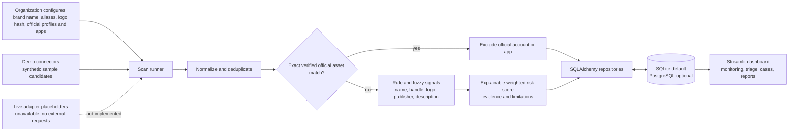

# BrandPhantom

BrandPhantom is a Streamlit demonstration of a digital-risk-protection workflow for brand impersonation across social profiles and mobile-app listings. The scan pipeline normalizes candidates, excludes configured verified brand assets, calculates explainable heuristic risk scores, stores findings/evidence, and supports analyst review and investigation tracking.

## What is implemented

- Tenant-scoped brand profiles, official social/app assets, aliases, and approved domains.
- Database-backed dashboard, scan history, findings triage, investigations, and CSV reports.
- Deterministic fuzzy name/handle/text analysis, suspicious-affix and scam-language indicators, package/publisher checks, and perceptual-hash comparison.
- Signal-level explanations and evidence limitations; missing data is not treated as malicious evidence.
- SQLite by default, SQLAlchemy persistence, and Alembic configuration.
- Demo connectors produce synthetic candidate profiles/listings, explicitly labelled in the UI and database.

## Demo mode and important limitations

- By default `DEMO_MODE_ENABLED=true`. A new, empty database is seeded with a synthetic NovaPay tenant and demo accounts. The seed workflow runs synthetic candidates through the real rule/scoring/database pipeline. These records are examples only—not verified threats or live platform observations.
- In local demo mode, use the Admin, Analyst, or Viewer role-selection button on the sign-in screen. These passwordless shortcuts are disabled in production; seeded demo accounts receive random undisclosed password hashes.
- Twitter/X, Instagram, Google Play, and Apple App Store adapters are placeholders. They do not query external services, even if credentials are configured; the UI reports them unavailable. No live, private-account, real-time, or external-threat-intelligence access is claimed.
- Detection is deterministic heuristic/fuzzy matching, not a trained AI/ML model. A similarity match or score is an indicator, not proof of fraud. Analyst verification is required.
- Candidate URLs are displayed as plain text; the application does not visit suspicious URLs. Remote image fetching is disabled in the perceptual-hash helper; callers must provide trusted bytes or a local image.
- User provisioning and production-grade identity/session management are not implemented. `APP_SECRET_KEY` is currently a configuration guard only; the application does not use it to sign sessions or tokens. Do not expose this demo app as a production authentication system.

## Architecture



## Short demo walkthrough

1. Start the app and choose the demo Admin role. Point out the synthetic-data banner and the unavailable live connector statuses.
2. In **Brands**, inspect the seeded NovaPay official social account and app listing. Register a sample brand to demonstrate aliases, verified assets, and optional logo-image hashing.
3. Run a scan. The built-in connectors generate clearly labeled synthetic examples; the scan applies the same normalization, verified-asset exclusions, scoring, evidence, and persistence pipeline used by the prototype.
4. Open **Social Monitoring** and **Mobile App Monitoring**. Compare the synthetic look-alike candidates and show that configured official accounts/apps are excluded. Emphasize that similarity is a heuristic signal, not proof.
5. Open a finding, inspect its factor-by-factor explanation, update its review status, open an investigation, then visit **Scan History** and **Reports & Exports**.

For a live presentation, use only the demo database and do not imply that any displayed candidate was collected from a real platform.

## Prerequisites

- Windows 10/11 with Python 3.10 or newer. Python 3.14 is supported by the current dependency set; the setup commands below use the Python launcher (`py`).
- PowerShell opened in the project directory (`D:\projecth`).
- SQLite is included with Python. PostgreSQL additionally requires a reachable database and valid `DATABASE_URL`; a driver is declared in `requirements.txt`.

## Install and configure (PowerShell)

From `D:\projecth`:

```powershell
py -3 -m venv .venv
.\.venv\Scripts\python.exe -m pip install --upgrade pip
.\.venv\Scripts\python.exe -m pip install -r requirements.txt -r requirements-dev.txt
if (-not (Test-Path .env)) { Copy-Item .env.example .env }
```

The application defaults to local SQLite and synthetic demo data. To use a PostgreSQL database, set `DATABASE_URL` in `.env` to a SQLAlchemy URL for that database. Do not put real credentials in source control or paste them into logs.

For a non-demo deployment configuration, set `APP_ENV=production`, set `DEMO_MODE_ENABLED=false`, and replace the `APP_SECRET_KEY` placeholder with a unique random value of at least 32 characters. The app refuses production mode with demo data enabled or an unchanged/short key. This check does not make the current login implementation production-ready; see limitations above.

## Run

The entry point is `app.py`:

```powershell
.\.venv\Scripts\python.exe -m streamlit run app.py
```

Open the local URL printed by Streamlit (normally `http://localhost:8501`). The app creates missing SQLAlchemy tables at startup. On the first empty SQLite database, demo mode seeds the sample tenant, users, brand, candidate records, findings, and an investigation. Later launches reuse the database rather than reseeding the tenant.

To run a scan for another configured brand, sign in as the demo administrator or analyst, open **Brands**, and use **Run Scan**. The built-in connectors return synthetic sample candidates; the scan itself persists observations, findings, evidence, signals, and scan history. Use **Findings Triage** to update dispositions or create an investigation.

## Database and migrations

- Default database: `sqlite:///./brandphantom.db` (relative to the process working directory). Keep the working directory at the project root for the documented commands.
- The app's startup `init_db()` creates missing tables using SQLAlchemy metadata.
- The initial Alembic revision was empty; a generated follow-up now creates the 21 model tables. To initialize a new/empty database with migrations, set `DATABASE_URL` and run:

  ```powershell
  .\.venv\Scripts\python.exe -m alembic upgrade head
  ```

- The pre-existing local `brandphantom.db` may already contain tables created by `create_all()` and has no Alembic revision stamp. Do not run `alembic upgrade head` against it: back it up and review/adopt its schema before stamping or migrating. Alembic takes its URL from `DATABASE_URL`.
- The default local database is disposable demo data and is excluded by `.gitignore`.

## Tests and static checks

```powershell
.\.venv\Scripts\python.exe -m pytest -q
.\.venv\Scripts\python.exe -m ruff check .
```

The tests use isolated in-memory SQLite databases. A passing suite validates code-level workflows, not real third-party integrations or production deployment.

## Troubleshooting

- **`streamlit` is not recognized:** run it as a module from the project venv: `.\.venv\Scripts\python.exe -m streamlit run app.py`.
- **Import/dependency errors:** confirm PowerShell is in `D:\projecth`, then rerun the install command using `.\.venv\Scripts\python.exe -m pip`.
- **No findings:** confirm a brand exists, demo mode is enabled for synthetic records, and use the brand's **Run Scan** action. A scan can complete with zero new findings if it only encountered previously stored candidates.
- **Live connectors unavailable:** expected. Credentials alone do not implement or activate external collection.
- **Database path surprises:** `DATABASE_URL`'s SQLite relative path is resolved from the current working directory. Launch from the project root or configure an absolute SQLite path.
